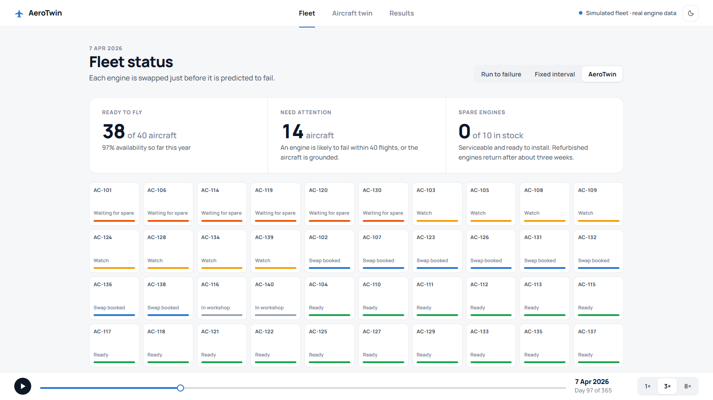
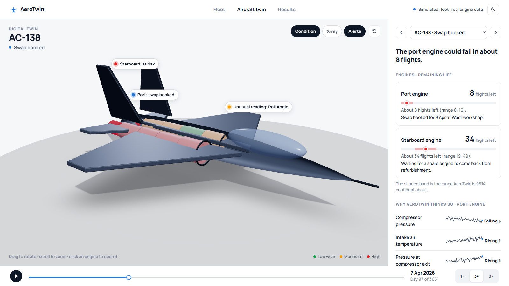
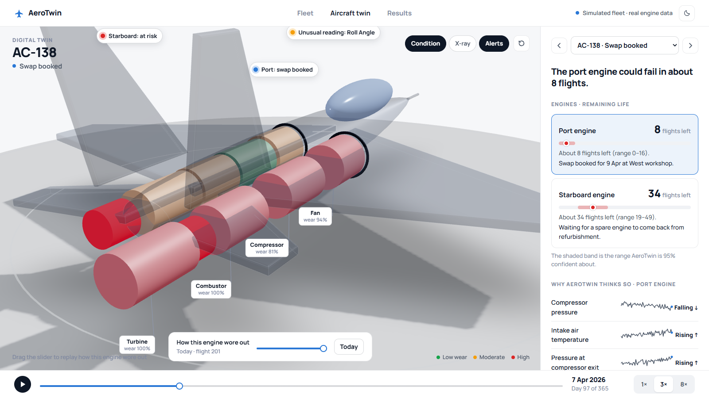
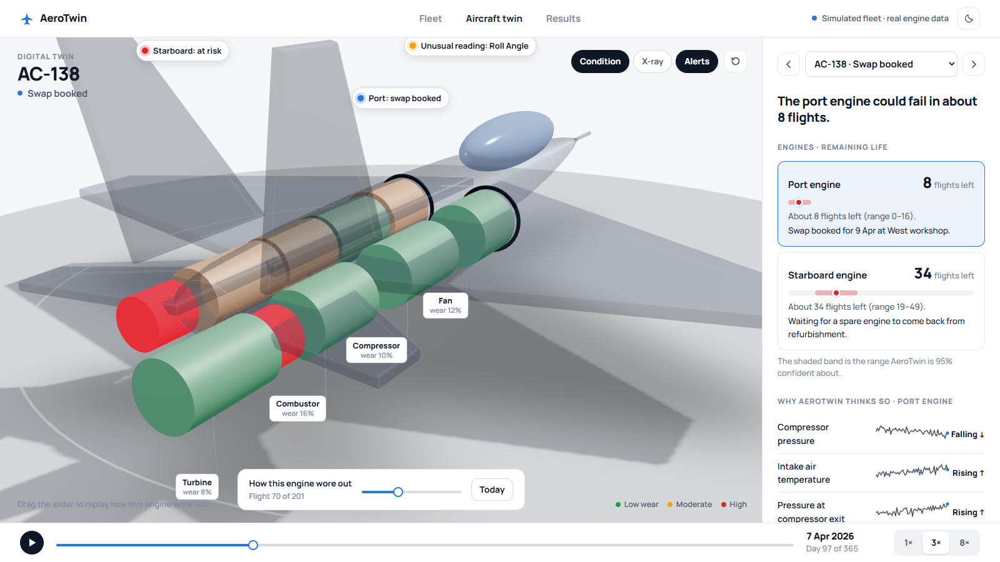
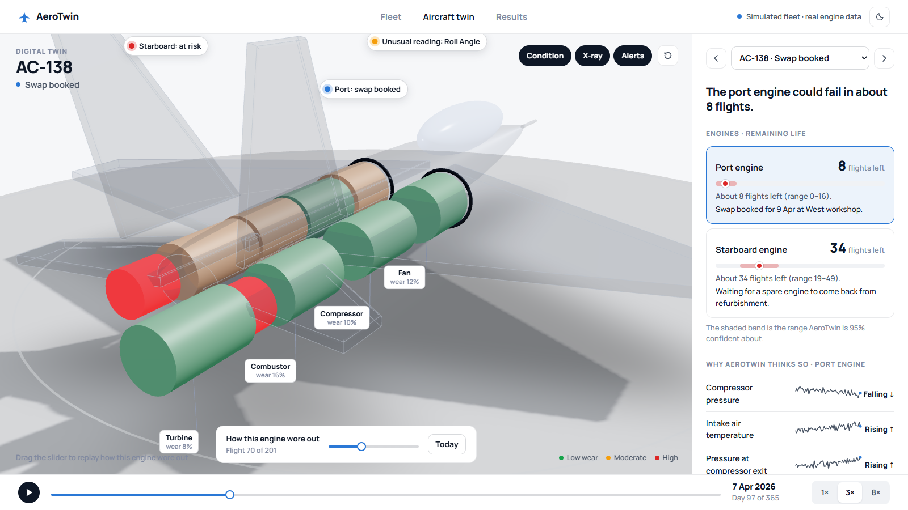
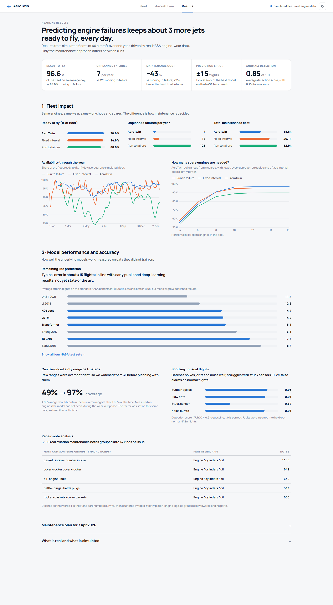
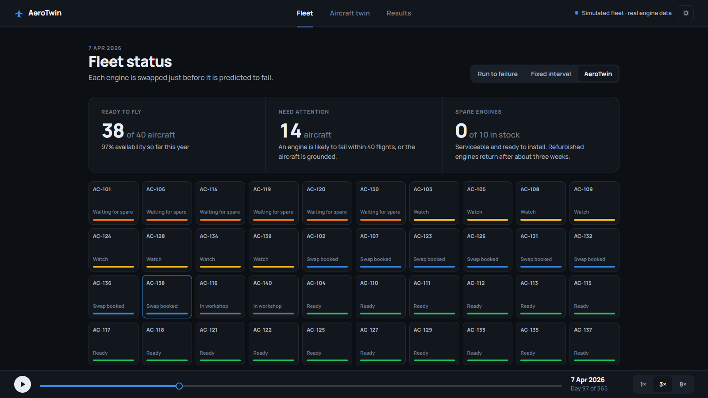

# AeroTwin — Predictive Maintenance & Fleet Availability

## 1. Project Information

- **Project Title:** AeroTwin — Predictive Maintenance & Fleet Availability
- **PS ID:** SIH26249
- **PS Title:** Air Power - Predictive Maintenance & Fleet Availability
- **Category:** Software
- **Theme:** Transportation & Logistics
- **Organisation:** Ministry of Defence (MoD)
- **Department:** Defence Services Staff College

### Team

| Name | Role | Responsibilities |
|---|---|---|
| Praneel Maumdar | Team lead / ML | RUL model architecture, MC-dropout uncertainty, out-of-fold evaluation |
| Rohit Kumar Singh | Backend | FastAPI replay service, API design, end-to-end pipeline orchestration |
| Amit Patel | Data engineering | Dataset adapters, C-MAPSS preprocessing, flight-anomaly autoencoder |
| Himanshu Yadav | Frontend | 3D digital twin, fleet and results dashboard, theming |
| Keshav Mittal | Optimisation research | Fleet simulator, CP-SAT scheduler, maintenance-policy baselines |
| Nikita Gupta | Documentation / QA | Literature survey, benchmarks, screenshots, submission materials |

## 2. Problem Statement

Low aircraft availability due to fragmented and largely reactive
maintenance practices across the air fleet. Maintenance data from
aircraft health-monitoring systems, technical records, spares and
maintenance agencies is not adequately integrated, resulting in delayed
fault prediction, avoidable aircraft downtime and sub-optimal
utilisation of critical assets.

## 3. Proposed Solution

AeroTwin integrates engine health data, flight data, maintenance
records, spares and workshop capacity into one platform and turns them
into decisions:

1. **Predict** how many flights each engine has left (remaining useful
   life, RUL), with an uncertainty range.
2. **Plan** engine swaps every day with a constraint solver that
   respects workshop slots and the spare-engine pool, so each swap
   happens just before the predicted failure: not too early (wasted
   engine life) and not too late (a breakdown).
3. **Show** the result in a dashboard with a 3D digital twin of every
   aircraft, so a maintainer can see which engine is wearing, why, and
   what is booked.

Unlike a dashboard that only visualises sensor history, AeroTwin closes
the loop: the same simulated fleet is replayed under two baseline
strategies (run to failure, fixed interval) so the benefit is
**measured, not claimed**.

> **What is real and what is simulated.** No public military data
> exists. Engine wear is **real NASA C-MAPSS run-to-failure data**. The
> fleet (40 aircraft, 80 engines), three workshops, the spare-engine
> pool, costs and the repair notes attached to events are **simulated**,
> and the UI says so. Every prediction driving the demo comes from a
> model that never trained on that engine (5-fold out-of-fold).

## 4. Key Features

- Remaining-useful-life models (XGBoost, 1D-CNN, LSTM, Transformer) on
  NASA C-MAPSS FD001–FD004 with **Monte Carlo dropout uncertainty**,
  recalibrated so the 95% range really covers about 95% of cases.
- **5-fold out-of-fold predictions** drive the fleet simulation, so no
  engine is ever scheduled by a model that saw it during training.
- Flight-data anomaly detection: a convolutional autoencoder trained on
  nominal NASA flight windows, threshold set from nominal data only,
  with a per-parameter breakdown of what drove each flag.
- Maintenance-log analysis: domain-aware cleaning (keeps "not" and part
  numbers), TF-IDF, LSA and k-means issue clusters, component tagging.
- Fleet simulator and **rolling-horizon CP-SAT scheduler** (Google
  OR-Tools) under workshop-slot and spare-engine limits, compared
  against two baselines and a perfect-RUL reference.
- Web dashboard in plain-but-technical language: **Fleet**, **Aircraft
  twin** (hover, open an engine into labelled sections, Condition /
  X-ray / Alerts layers, a "how this engine wore out" slider) and
  **Results**. Light theme by default, dark theme on toggle.
- **One-command pipeline** that downloads the data, trains, simulates,
  builds the report and the UI — every step skipped if its output
  already exists.
- Benchmarked against published C-MAPSS results and against two
  maintenance baselines on identical fleets, with a spare-pool
  sensitivity sweep — see [reports/benchmark.md](reports/benchmark.md).

## 5. Technology Stack

- **ML / modelling:** PyTorch (1D-CNN, LSTM, Transformer), XGBoost,
  scikit-learn
- **Optimisation:** Google OR-Tools (CP-SAT)
- **Data:** pandas, NumPy, SciPy; NASA C-MAPSS, NASA DASHlink flight
  data, MaintNet maintenance logs
- **Backend:** FastAPI + Uvicorn (REST, also serves the built frontend)
- **Frontend:** React, Vite, Three.js (React Three Fiber)
- **Language:** Python 3.11, JavaScript

## 6. Architecture

```
NASA C-MAPSS run-to-failure data (FD001-FD004)
        │
        ▼
src/ml — remaining-life models
  - 14 sensors (7 constant ones dropped), min-max scaled per operating regime
  - stride-1 windows of 30 cycles, RUL label capped at 125
  - XGBoost / 1D-CNN / LSTM / Transformer, dropout kept on at inference
  - Monte Carlo dropout (30 passes) → mean μ and spread σ per engine, per cycle
  - oof.py: 5-fold out-of-fold RUL for every FD001 engine at every cycle
        │
NASA DASHlink ──► src/anomaly — conv autoencoder (latent 96)          ┐
flight windows      trained on nominal flights only; threshold =      │
                    99th pct of nominal validation error              │
                                                                      │
MaintNet logs ───► src/nlp — TF-IDF → LSA(80) → k-means issue         │
6,169 real notes     clusters + component taxonomy                    │
                                                                      ▼
                              src/fleet — simulator + CP-SAT scheduler
                                - 40 aircraft × 2 engines, 365 days
                                - 3 workshops × 1 start/day, 10 spares (20-day refurb)
                                - alarm when P(fail within 40 flights) > 3%
                                - CP-SAT over a 30-day rolling horizon, re-solved daily:
                                    min  C_fail·P(fail before d) + (C_engine/L)·E[wasted life]
                                - policies: run to failure · fixed interval · AeroTwin · perfect-RUL
                                             │
                                             ▼
                              demo/backend — FastAPI over the precomputed replay
                                /api/meta · /fleet · /aircraft/{a} · /schedule
                                /kpis · /sensitivity · /models
                                (no torch at run time, low RAM)
                                             │
                                             ▼
                              demo/frontend — React + Vite + Three.js
                                Fleet · Aircraft twin · Results, light + dark
```

See [docs/architecture.md](docs/architecture.md) for the full write-up —
data sources, model pipeline, scheduler objective and constraints,
endpoint reference, and the limitations/scope notes. The papers behind
the design are in [docs/literature_survey.md](docs/literature_survey.md)
(24 papers, stating what was and was not verified from source).

**Headline results** (8 simulated fleets × 40 aircraft × 365 days, real
C-MAPSS engine lives, identical failures across strategies): **96.6%**
availability and **7** unplanned failures a year, against 88.9% / 125
for run-to-failure and 94.6% / 18 for the best fixed interval — at
**43% lower cost**. Remaining-life prediction on FD001 reaches RMSE
**14.7** flights. Full tables, the spare-pool sensitivity sweep,
uncertainty calibration and the anomaly-detection breakdown are in
[reports/benchmark.md](reports/benchmark.md).

## 7. Repository Structure

```text
AeroTwin/
├── README.md · SUBMISSION_GUIDE.md · requirements.txt
├── src/                        # all Python
│   ├── paths.py                #   single source of truth for data/ models/ reports/
│   ├── download_datasets.py    #   fetch C-MAPSS, DASHlink, MaintNet (~230 MB)
│   ├── pipeline.py             #   one-command end-to-end run (--force, --serve)
│   ├── make_report.py          #   result JSON -> reports/benchmark.md
│   ├── ml/                     #   remaining-life models
│   │   ├── data.py             #     windows, scaling, RMSE + PHM08 score
│   │   ├── models.py           #     1D-CNN, LSTM, Transformer (dropout kept on)
│   │   ├── train.py            #     train/eval 4 models x 4 subsets x 3 seeds
│   │   └── oof.py              #     5-fold out-of-fold RUL for the fleet
│   ├── anomaly/detector.py     #   conv autoencoder on nominal flight windows
│   ├── nlp/logs.py             #   TLP cleaning -> TF-IDF -> LSA -> k-means
│   └── fleet/                  #   simulation and scheduling
│       ├── sim.py              #     world, policies, CP-SAT rolling horizon
│       ├── compare.py          #     all policies over 8 fleets + replay capture
│       ├── extras.py           #     attach anomalies and repair notes to the timeline
│       └── sensitivity.py      #     availability vs spare-pool size
├── demo/
│   ├── backend/app.py          # FastAPI over the replay; also serves the built UI
│   ├── frontend/               # React + Vite + Three.js
│   │   └── src/                #   App, components/, scene/TwinScene.jsx, styles.css
│   └── screenshots.py          # regenerate assets/screenshots (Playwright)
├── docs/
│   ├── architecture.md         # full technical write-up
│   ├── literature_survey.md    # 24 papers behind the method
│   └── problem_statement.txt   # the SIH problem statement, verbatim
├── reports/                    # tracked result files + generated benchmark.md
├── assets/screenshots/         # captioned screenshots of the running demo
├── submission/                 # PRESENTATION.md · DEMO.md
├── data/                       # downloaded datasets (git-ignored)
└── models/                     # trained weights and replay pickles (git-ignored)
```

### What goes where?

| Item | Location |
|---|---|
| ML, NLP, anomaly and fleet code | `src/` |
| API + 3D dashboard | `demo/` |
| Architecture / technical documentation | `docs/architecture.md` |
| Literature survey | `docs/literature_survey.md` |
| Benchmarks and result files | `reports/` |
| Project screenshots | `assets/screenshots/` |
| Final PPT / presentation | `submission/PRESENTATION.md` |
| Demo video link | `submission/DEMO.md` |

## 8. Final Presentation

[View on Google Drive](https://drive.google.com/file/d/1FaXCgO1cnWS0HmVXmlaM3yUKPJN67sAh/view?usp=drive_link)

See [submission/PRESENTATION.md](submission/PRESENTATION.md) for the SIH
presentation.

## 9. Demo Video

[Watch on YouTube](https://youtu.be/ehU8d_xvV-Y)

See [submission/DEMO.md](submission/DEMO.md) for the link.

## 10. Screenshots / Prototype Photos

### The fleet view

Headline numbers (ready to fly, need attention, spare engines), the
status map of all 40 aircraft, and the strategy switch between *Run to
failure*, *Fixed interval* and *AeroTwin*.



### The aircraft twin

The 3D aircraft with alert pins — unusual flight reading, swap booked,
engine at risk — and a plain-language summary of each engine's remaining
life.



### An engine, opened up

Click an engine and it opens into Fan, Compressor, Combustor and
Turbine, coloured by wear, with the airframe faded so the engine is
visible.



### How this engine wore out

The wear slider scrubbed back to an earlier flight: the same engine's
sections recolour as degradation builds up from new to today.



### X-ray layer

The airframe turns into a ghost so both engines and their section wear
are visible at once.



### Results

The headline scorecard, fleet impact (strategy comparison, availability
through the year, spare-engine sensitivity) and model performance
(prediction accuracy, uncertainty calibration, anomaly detection,
repair-note analysis).



### Dark theme

The same views with the theme toggle in the top bar.



Every screen, with captions, is in
[assets/screenshots/](assets/screenshots/README.md).

## 11. Installation

Requirements: **Python 3.11**, **Node 18+**. An NVIDIA GPU speeds up
training but is not required.

```bash
git clone https://github.com/praneel08/AeroTwin.git
cd AeroTwin
python -m venv .venv && source .venv/bin/activate   # .venv\Scripts\activate on Windows
pip install -r requirements.txt
```

If you have an NVIDIA GPU, install a CUDA build of PyTorch **before**
the rest:

```bash
pip install torch --index-url https://download.pytorch.org/whl/cu121
```

AeroTwin re-creates everything from public data rather than shipping
checkpoints: `data/` and `models/` are git-ignored and rebuilt by the
pipeline below. The screenshot tool is optional and additionally needs
`playwright install chromium`.

Run every command from the repository root, as a module.

## 12. Run

### One command, end to end

```bash
python -m src.pipeline --serve
```

This downloads the data, trains the models, runs the simulation, writes
the report, builds the frontend and starts the app on
<http://127.0.0.1:8000>. Each step is **skipped if its output already
exists**; `--force` redoes everything. A full cold run is roughly 35–40
minutes on a laptop GPU, dominated by model training.

| What | Where |
|---|---|
| AeroTwin dashboard | <http://127.0.0.1:8000> |
| Interactive API docs (OpenAPI) | <http://127.0.0.1:8000/docs> |

Open the **Fleet** tab, switch the strategy control and press play on
the replay bar to watch the same fleet diverge. Click an aircraft to
open its **twin**, click an engine to break it into sections, and drag
*How this engine wore out*. The **Results** tab holds the scorecard and
the model benchmarks.

### Individual steps

```bash
python -m src.download_datasets          # ~230 MB into data/ (optional: --with-ngafid, +1.1 GB)
python -m src.ml.train --all --seeds 3   # RUL models -> models/ml, reports/ml_results.json
python -m src.ml.oof                     # out-of-fold predictions for the fleet
python -m src.anomaly.detector           # flight-anomaly autoencoder
python -m src.nlp.logs                   # maintenance-log clusters
python -m src.fleet.compare              # policy comparison + replay data
python -m src.fleet.extras               # attach anomalies and logs to the timeline
python -m src.fleet.sensitivity          # availability vs spare-pool size
python -m src.make_report                # reports/benchmark.md
cd demo/frontend && npm install && npm run build
python -m uvicorn demo.backend.app:app --port 8000
```

### Frontend development

```bash
python -m uvicorn demo.backend.app:app --port 8000   # terminal 1
cd demo/frontend && npm run dev                      # terminal 2, proxies /api to :8000
```

### Regenerate the screenshots

```bash
playwright install chromium
python -m demo.screenshots               # with the app running
```

## 13. Results

Same simulated fleets (8 worlds, 40 aircraft, 365 days, 3 workshops, 10
spare engines), same failures, different maintenance strategy:

| Strategy | Availability | Failures / yr | Planned swaps | Life wasted per swap | Cost |
|---|---|---|---|---|---|
| Run to failure (corrective) | 88.9% | 125 | 0 | – | 32.9k |
| Fixed interval (tuned to 140 flights on these same fleets) | 94.6% | 18 | 170 | 60 flights | 26.1k |
| **AeroTwin (predictive)** | **96.6%** | **7** | 134 | 12 flights | **18.6k** |
| Perfect-RUL reference | 95.6% | 20 | 118 | 10 flights | 20.2k |

The fixed interval is tuned on the same fleets it is scored on, which
favours that baseline. The perfect-RUL reference plans with a small
safety margin, so it is a reference point rather than a hard bound.
Spares are the binding constraint: AeroTwin pulls ahead from about 8
spare engines, and with fewer every strategy struggles (and the fixed
interval does slightly better).

**Remaining-life prediction**, test RMSE in flights (lower is better,
mean of 3 seeds): FD001 — XGBoost 14.7, LSTM 14.9, Transformer 15.1,
1D-CNN 17.4. Published references on FD001: Babu 2016 18.45, Zheng 2017
16.14, Li 2018 12.61, DAST 2021 11.43. One standard pipeline with no
per-subset tuning puts us in the range of the early deep-learning
baselines, not the 2021 attention models.

**Uncertainty.** The raw MC-dropout range covered only 49% of true
values in the wear-out phase, so it is rescaled ×3 (about 97% coverage)
before the scheduler uses it. The factor was chosen on this same data,
so treat it as optimistic.

**Flight-data anomaly detection** (faults injected into held-out nominal
flights): AUROC 0.93 spikes, 0.91 drift, 0.91 noise bursts, 0.67 stuck
sensors, with 0.7% false alarms on nominal flights.

All tables, generated from the result files:
[reports/benchmark.md](reports/benchmark.md).

## 14. Limits

- Fleet, workshops, spares, costs and maintenance-log attachments are
  simulation assumptions; the engine lives are real but come from one
  family of turbofan engines.
- The fixed-interval baseline and the uncertainty calibration factor are
  both tuned on the same simulated data they are evaluated on.
- Section-level wear (Fan, Compressor, Combustor, Turbine) is a
  sensor-drift index from an illustrative grouping of sensors; C-MAPSS
  does not label section-level faults.
- The link between flight anomalies and engine health is simulated:
  faults are injected into real nominal flights with probability rising
  as the engine degrades.
- Intended as **decision support for maintainers**, not autonomous
  maintenance authority.

## 15. Future Scope

- Per-subset tuning and attention architectures to close the gap to the
  2021 state of the art on C-MAPSS (FD001 RMSE 11.43).
- N-CMAPSS with real flight profiles, and physics-informed hybrids that
  feed calibrated health parameters into the network.
- Out-of-sample uncertainty calibration on a held-out fleet, so the ×3
  factor is no longer an in-sample choice.
- Multiple part types, repair-agency queues and leasing in the
  scheduler, beyond the single spare-engine pool.
- An ingestion seam for real aircraft health-monitoring feeds and
  technical records, replacing the simulated fleet layer.
